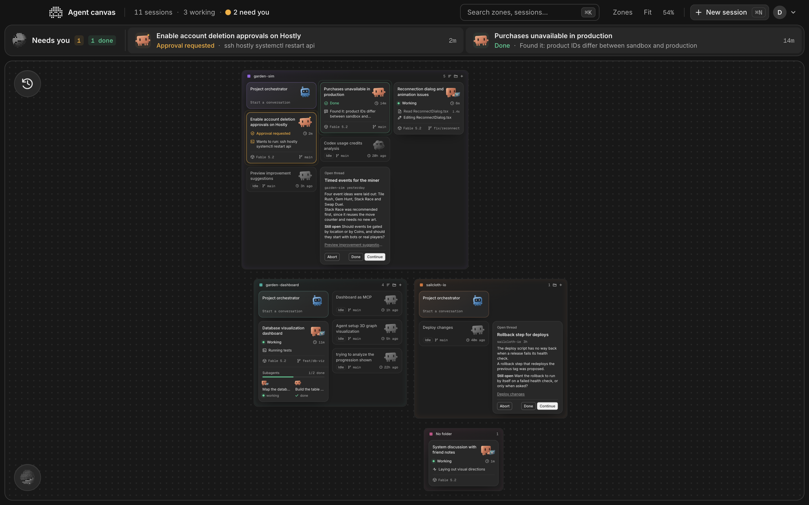

# Agent canvas

Agent canvas is a Mac app that shows your Claude Code sessions and Codex chats as cards on one
canvas, grouped into zones by project folder, and lets you chat with them. Open a card to get a
real chat: streamed replies, tool calls, approvals and questions inline, a composer with images,
Stop, and model and permission pickers. Beside the chat, **Live work** shows the commands, edits
and reads of the running turn, and **Browser** shows the app the session is building. A profile
page shows both accounts and how much of each plan's usage is left.

The canvas shows every live session plus each provider's 40 most recently used ones.



## Requirements

- A Mac with Apple silicon (the app is built for arm64)
- Node 24 or later, to build it
- For Claude Code login: Claude Code's CLI (`claude`) installed, to log in once (see below). Chats run on
  the Claude Code that comes with the app's Agent SDK, but the login itself is made with `claude`.
- For Codex: install `codex`. Regular project sessions use `codex login`. Each time Canvas starts a Codex app server, it
  selects the newest installed CLI from your login shell, the usual install folders, and the
  ChatGPT app. It reads the available models from that server. Active chats keep their server
  until it exits or you quit Canvas.

### Log in to Claude once

The Claude desktop app's login cannot be used by another program. Install Claude Code's CLI
(`claude`, see https://docs.anthropic.com/en/docs/claude-code) if you do not have it, and log in
with it once, in a terminal:

```sh
claude
```

then type `/login` and follow the steps. Until then Claude cards stay read-only and the profile
page says how to log in. Agent canvas never handles the login itself.

## Install

```sh
npm ci
npm run install-app
```

`install-app` builds the app and copies `Agent canvas.app` to `/Applications`. If a copy is
already there it asks before replacing it, and if that copy is running it asks you to quit it
first. The built copy in `release.noindex/` is then removed, so Launchpad and Spotlight list one app. Open Agent canvas from Launchpad or Spotlight afterwards. The app is unsigned: it is
built on this Mac for this Mac only.

To build without installing:

```sh
npm run package     # release.noindex/mac-arm64/Agent canvas.app
```

To run from the source folder instead:

```sh
npm run app
```

## Permissions

On first launch, review notifications for background approvals and usage resets, and check which agent is signed in. One provider is enough to start. Choose **Skip for now** to dismiss the current setup items or **Don’t show again** to disable automatic setup. Reopen it from **Profile → Permissions**. macOS handles project-folder access when you open protected folders.

Other command-line agents can connect through the Agent Client Protocol. See [ACP setup](docs/acp.md).

## Closing and quitting

Closing the window keeps the app and every session running; the app stays in the Dock and
the window comes back when you click it. The Dock icon shows how many sessions need you.

Quit with ⌘Q (or Quit from the menu or the Dock). Quitting never cuts a session short: the
canvas only shows them. With a turn running or a session waiting for you, the window and Dock
icon go away and the app keeps running unseen until every session has finished, then exits by
itself. A session that needs an approval or answer meanwhile sends a notification; opening
Agent canvas again brings everything back as it was. Shutting down the Mac, or a signal
(Ctrl+C on `npm run app`), stops the sessions at once. What each session has said is saved by
Claude Code or Codex, so it can be resumed later, here or in their own apps.

## Demo mode

```sh
npm run build
npx electron dist-electron/main.js --demo         # eleven invented sessions
npx electron dist-electron/main.js --demo=large   # forty invented sessions
open "release.noindex/mac-arm64/Agent canvas.app" --args --demo   # the packaged app (after npm run package)
```

Demo mode drives no real Claude or Codex session: scripted ones stand in. It reads neither
provider's data and writes nothing to `~/.agent-canvas`, so it can run beside the real app.

## Using it

- Each folder gets a zone. Create your own zones from the Zones menu; deleting one sends its
  cards back to their folder zones. Drag a zone by its label to move it; double-click the label
  (or press Enter on it) to rename it. Click the colored marker or right-click the zone to edit
  its name, color, and icon. Drag a card onto another zone to move it there.
- ⌘K finds a session by name, folder or provider. F fits all zones on screen. ⌘N starts a new
  session: pick Claude or Codex, a folder, a model and a permission mode.
- Terracotta Clawd creatures are Claude Code sessions; purple Dot creatures are Codex chats.
- "Needs you" means the session is waiting on you: a permission, a question, or a finished turn
  you have not looked at yet.
- When another app holds a Codex chat, send from Canvas to add your message to that chat’s
  Codex queue. The other app controls the model, permissions and turn. To run the chat in
  Canvas, close it in the other app and choose **Move here**.
- A Claude session open elsewhere accepts messages from Canvas between turns.

### Canvas agent connection

Open **Profile → Canvas agent** to choose **Claude Code login**, **Claude API**, or **Codex API**.
For an API connection, enter your Anthropic or OpenAI API key and choose **Save connection**.
Press ⌘J and choose **New conversation** to use it. Each conversation keeps its original
connection when resumed. API usage is billed to the account that owns the key. The canvas agent
can use its canvas tools with either provider.

### Project orchestrators

The canvas agent hands project work to a persistent orchestrator for the selected folder.
It reviews the project's chat titles, branches, state and recent messages before it reuses a
worker or starts a named chat. It can choose a worker model and thinking level to fit the
task. Handoffs and worker actions appear in their respective chats for approval.

Each project zone has a **Project orchestrator** chat pinned first alongside the other chats. Click it to
open the existing conversation or give the orchestrator its first task. You can also send a
brief from **New session → Orchestrator**.
Choose **Claude** or **Codex** there to create a chat yourself. A new orchestrator uses the
canvas agent connection selected in Profile and keeps it when reopened.

## Your data

- Agent canvas's own data (zone layout, reply marks, the sessions started here and each
  chat's model and mode) lives in `~/.agent-canvas/`, readable only by you. Set
  `AGENT_CANVAS_HOME` to use another folder.
- It reads Claude Code's transcripts under `~/.claude` and Codex's thread data under `~/.codex`
  (`CLAUDE_HOME` and `CODEX_HOME` point the app's reader elsewhere; they are not passed to the
  Claude Code and Codex it runs, which keep their own folders). API keys entered for the canvas agent are stored in macOS Keychain under `Agent Canvas API`.
  It never reads `~/.codex/auth.json` or `~/.claude/sessions/*.key`, and never connects to a session's messaging socket.
- The only writes under `~/.claude` and `~/.codex` are what Claude Code and Codex write
  themselves while running a session, and the "Always allow" rules you pick in an approval.
- Canvas state stays on your Mac. Your configured agents and tools contact their providers, and opening a URL in the preview contacts that site. The canvas loads its fonts locally and includes no analytics.

## If you installed version one

Version one ran a background reader as a login item. Agent canvas no longer uses it; remove it
once:

```sh
rm -f ~/Library/LaunchAgents/com.agent-canvas.reader.plist && launchctl bootout gui/$UID/com.agent-canvas.reader
```

If `launchctl` says the service is not found, it was already gone.

## Known limits

- Sessions run here load the plugins and MCP servers installed through Claude Code, but not
  the ones the Claude desktop app adds on its own; the chat header says so.
- Whether sessions started here appear in the Claude app's own list is not yet known; they can
  always be resumed with `claude --resume <id>`.
- The session files and transcripts are the providers' internal formats. An update may change
  them; a session the app cannot understand shows as "Unknown" rather than breaking the canvas.
- The Codex app server is marked experimental by OpenAI, and Claude's usage numbers come from
  an experimental SDK call. A new Codex conversation item that Canvas cannot display appears
  as an “Unsupported item” notice in that chat.
- Zones are keyed by folder name, so two projects whose folders have the same name share one zone.

## Development

```sh
npm run dev         # Vite with hot reload (http://127.0.0.1:5173) and the app in demo mode
npm test            # unit tests
npm run typecheck   # TypeScript, no output
npm run test:e2e    # builds, then drives the app in demo mode (Playwright); screenshots in e2e/shots/
npm run package     # the unsigned arm64 app in release.noindex/mac-arm64/
npm run icon        # redraws build/icon.png and build/icon.icns from the canvas agent’s globe
```
